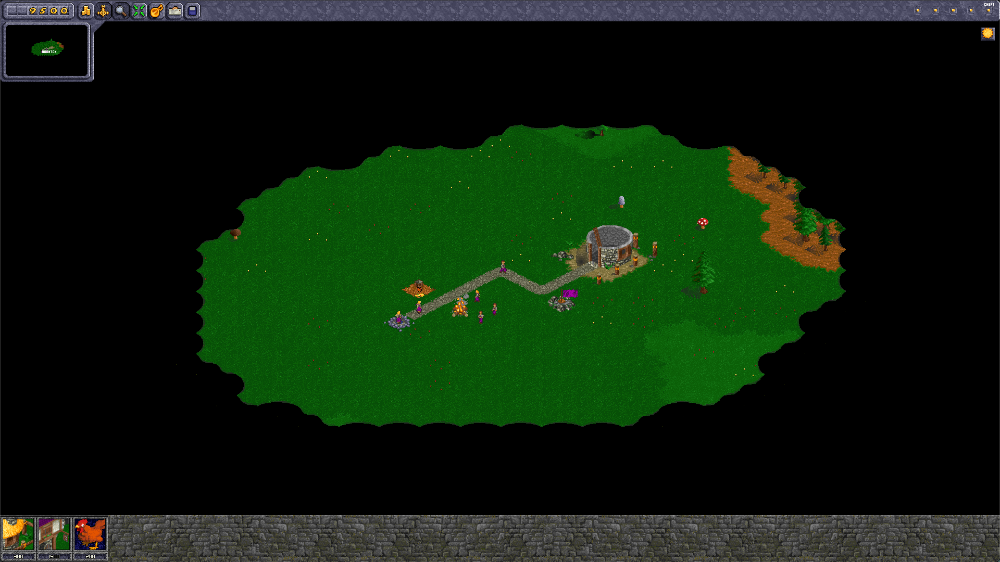
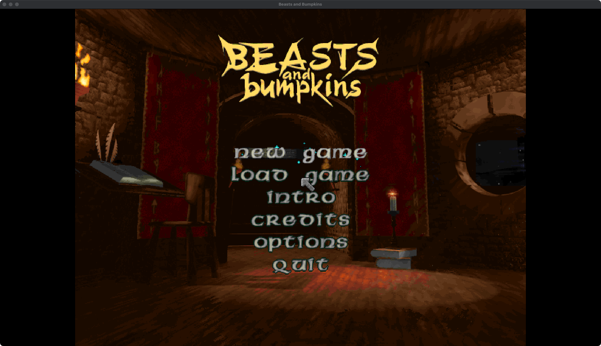

# Beasts & Bumpkins Patch

An unofficial, fan-made patch that gets the 1997 Worldweaver/EA game Beasts & Bumpkins running well on modern machines, then improves it: higher resolutions, a resizable window or fullscreen, quicksave, keyboard scrolling and skippable movies. You apply it to your own copy of the original disc. Supported targets:

- **macOS** via [CrossOver](https://www.codeweavers.com/crossover) (tested on Apple Silicon, CrossOver 26.3)
- **Windows** 10/11, natively (scripted but not yet tested on real hardware)

See `plans/beasts-and-bumpkins-restoration.md` for the roadmap and `research/` for verified findings.

**This is a community project and help is very welcome.** Whether you can test on Windows, have a different disc version, know your way around x86, or just want to report how it ran for you, see [Contributing](#contributing).

<p align="center">
  
</p>
<p align="center">
  
</p>
<p align="center"><em>A mission at 1920x1080 (top), and the 640x480 main menu scaled up in the same 1920x1080 window with the new OPTIONS entry (bottom)</em></p>

## This repo contains no game files

You need to supply the game yourself. The scripts only work with the English EU CD release (the `BEASTS.EXE` with md5 `2d2852fcb22e6f65a0cf3415abaf4411`) and refuse anything else. Everything generated (extracted files, patched exe, music, downloaded wrappers, logs) goes into the ignored `.local/` folder.

Hashes of the tested disc image (`BEASTS&BUMPKINS.bin` and `.cue`) are in `research/disc-and-executable.md`.

## What gets changed

| Fix                         | How                                                                                                                                                                                |
| --------------------------- | ---------------------------------------------------------------------------------------------------------------------------------------------------------------------------------- |
| No CD needed                | 5-byte patch to a copy of `BEASTS.EXE` (from [bb-patch](https://github.com/bb-patch/bb-patch)), original bytes checked first                                                       |
| No installer needed         | Registry values the game reads are written directly                                                                                                                                |
| Black screen, jumping mouse | [cnc-ddraw](https://github.com/FunkyFr3sh/cnc-ddraw) v7.1.0.0 renders the 640x480 game into a scaled window and manages the cursor                                                 |
| Slow gameplay               | Also cnc-ddraw: it replaces DirectDraw outright, which covers the slowdown bb-patch fixes with dxwrapper/DDrawCompat                                                               |
| CD music                    | Audio tracks ripped from the disc image to OGG, played by [ogg-winmm](https://github.com/ayuanx/ogg-winmm) v2025.01.16 (see below)                                                 |
| Developer mode (cheats)     | Optional 4-byte patch (`install --console`), from bb-patch. `--console-key F12` or `Z` moves it off F11                                                                            |
| Bigger map view             | Missions run at the resolution chosen in the main menu's OPTIONS page (up to 1920x1080), with the HUD stretched to fit; menus, briefings and videos stay 640x480 and are scaled up |
| Window or fullscreen        | OPTIONS page or Alt+Enter; the window keeps the chosen size and both settings are remembered                                                                                       |
| Quality of life             | WASD camera scrolling, F5 quicksave and F9 quickload in missions, any key or click twice to skip a movie                                                                           |

Wrappers are downloaded from their GitHub releases and checked against pinned SHA-256 hashes.

## Requirements

- Python 3.9+ (`python3` on macOS, `py` on Windows)
- An OGG Vorbis encoder for the music (optional, the game runs without it):
  - macOS: `brew install vorbis-tools`
  - Windows: `oggenc.exe` from vorbis-tools, or an `ffmpeg` build with libvorbis, on your `PATH`
- macOS only: CrossOver in `/Applications`

## Setup

```sh
# 1. Extract the disc, patch the exe, download wrappers, encode music
python3 scripts/bb.py prepare --cue "/path/to/BEASTS&BUMPKINS.cue"

# 2. Install
python3 scripts/bb.py install
#    macOS: creates/uses the CrossOver bottle "BeastsAndBumpkins" (--bottle NAME to change)
#    Windows: installs to C:\Games\Beasts (--target DIR to change, avoid Program Files)
#    --no-music skips the CD music wrapper
#    --resolution 1280x720 sets the starting mission resolution and window size
#      (default 640x480; change it later from the main menu's OPTIONS page)
#    --console enables developer mode on F11
#    --console --console-key Z (or F12) uses another key; macOS takes F11 for Show Desktop

# 3. Play
python3 scripts/bb.py run               # window or fullscreen, as last chosen in game
python3 scripts/bb.py run --fullscreen  # force borderless fullscreen (--window forces a window)
python3 scripts/bb.py stop              # close a running game (install and run do this first)
```

The main menu's OPTIONS page has:

- **Resolution** cycles the mission resolution. About a second after you stop on one, the window resizes to it and then stays that size: menus, briefings and videos (640x480) are scaled up into it.
- **Display** switches between a window and borderless fullscreen (same as Alt+Enter). Both settings are kept for the next launch.

On Windows use `py scripts\bb.py ...`. In game, Alt+Enter switches between window and fullscreen and Ctrl+Tab releases the mouse. Logs go to `.local/logs/`.

Re-running `install` refreshes the game files and keeps saves (`savegam*.sav` in the game folder).

### Developer mode

With `--console`, the developer key (F11 by default) cycles through three modes, shown top-right:

- **Edit** (`CHEAT`): single keys, e.g. `G` lots of gold, `o103` spawn a man or woman, `o110` a cow, `C` duplicate the last object, Ctrl+F6 remove fog of war
- **Script**: type `loadmission`, Enter, then a mission number (1-30)
- third press returns to normal play

With `--console-key Z`, Z can't be typed in Script mode.

## Why the wrappers

The game asks DirectDraw for a 640x480 fullscreen mode. On macOS the display can't switch to that, so with CrossOver's builtin DirectDraw the game draws in a corner and goes black; a Wine virtual desktop fixes the picture but the game's cursor warping makes the view jump. cnc-ddraw draws into a normal scaled window and owns the cursor, which fixes both and also avoids mode-switch problems on modern Windows. Settings live in `config/cnc-ddraw/ddraw.ini`.

The game plays music with MCI `cdaudio` commands from the disc's 7 audio tracks, so without a disc there's no music. ogg-winmm intercepts those calls and plays `Music/Track02.ogg` to `Track08.ogg` instead.

ogg-winmm v2025.01.16 forwards `open cdaudio` to the real winmm with a NULL parameter block, which crashes the game under Wine at startup ([ayuanx/ogg-winmm#25](https://github.com/ayuanx/ogg-winmm/issues/25)). Upstream removed that call in commit `11c13ec` but hasn't released it, so `bb.py` NOPs the same call in the downloaded DLL (8 bytes at file offset `0x1955`, with original and patched hashes pinned).

## Scripts

| Script               | Purpose                                                                                                                                                                                    |
| -------------------- | ------------------------------------------------------------------------------------------------------------------------------------------------------------------------------------------ |
| `scripts/bb.py`      | Main CLI: `prepare`, `install`, `run`, `stop`                                                                                                                                              |
| `scripts/bbpatch.py` | Verified patches: `nocd` (default), `console`, `qol` (WASD scrolling, F5 quicksave, F9 quickload, press any key or click twice to skip a movie; always installed by `bb.py`), `screenmode` |
| `patches/*.asm`      | Our own x86 code patches (nasm source plus the assembled `.bin`)                                                                                                                           |
| `scripts/bincue.py`  | Split BIN/CUE into ISO data track and WAV audio tracks                                                                                                                                     |
| `scripts/iso9660.py` | Extract files from the ISO data track (pure Python)                                                                                                                                        |
| `scripts/peinfo.py`  | Print hashes, PE header, sections and imports                                                                                                                                              |

## Rollback

Your disc files are never modified. To reset, back up your saves, delete the game folder (or the CrossOver bottle) and rerun `install`.

## Development

The code patches are x86 assembly in `patches/*.asm`. The assembled `.bin` files are committed, so playing needs no assembler. After editing a patch, rebuild with [nasm](https://www.nasm.us/) (`brew install nasm`) and reinstall:

```sh
python3 scripts/bbpatch.py assemble
python3 scripts/bb.py install --resolution 1280x720
```

`research/` holds the reverse-engineering notes (addresses, data layouts, how each hook works) and `plans/` the roadmap.

## Contributing

This started as one person wanting to play an old favourite again, and it will go a lot further with more people involved. Issues, pull requests, test reports and ideas are all welcome, and you don't need to be an assembly expert to help.

Good places to start:

- **Test on Windows.** The Windows path is scripted but hasn't been run on real hardware yet. A report saying "it worked" or "it broke here" is genuinely useful.
- **Other disc versions.** Only the English EU CD is supported. If you have another release (US, German, French, a budget re-release), the hashes and a note on what differs would help us support it.
- **Report how it plays.** Glitches at particular resolutions, HUD elements in the wrong place, crashes, slowdowns. Screenshots and your OS, resolution and window/fullscreen setting make bugs much easier to chase.
- **More fixes and features.** Wider aspect ratios, HUD polish, more quality-of-life keys, better scaling. Open an issue first if it's a big change so we can talk it through.
- **Reverse engineering.** The longer-term goal is to understand enough of `BEASTS.EXE` to decompile and rebuild it. New findings about functions, data structures or file formats are valuable even without a patch, so add them to `research/`.
- **Docs.** Clearer setup steps, troubleshooting tips, or anything that tripped you up.

See [CONTRIBUTING.md](CONTRIBUTING.md) for how to build, test and send changes. Please never attach or commit game files (the EXE, disc images, extracted data or music); everything generated lives in the ignored `.local/` folder for that reason.

## Credits and licence

Licensed under the [GNU GPL v3](LICENSE). The no-CD and console byte patches derive from [bb-patch](https://github.com/bb-patch/bb-patch) (GPL-3.0). [cnc-ddraw](https://github.com/FunkyFr3sh/cnc-ddraw) (MIT) and [ogg-winmm](https://github.com/ayuanx/ogg-winmm) are downloaded at setup time, not redistributed here.

Beasts & Bumpkins is © Worldweaver Productions / Electronic Arts. This project is not affiliated with or endorsed by them, and includes none of the game's files.
